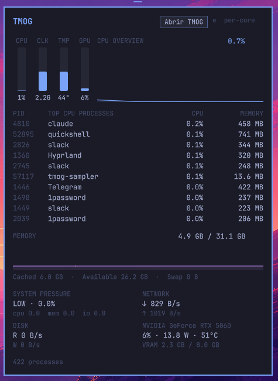

# TMOG

A bar glance at what [TMOG](https://tmog.org) shows: SYS gauges (CPU, clock,
temperature, GPU), CPU overview, top processes, memory, system pressure,
network, disk and GPU.



Click the bar icon to open the panel. `e` toggles a per-core CPU view, Esc closes.
The **open TMOG** button focuses the TMOG app if it is running, or starts it.
A small Python sampler runs only while the panel is open.

## Install

```bash
omarchy plugin add https://github.com/rodrigondec/omarchy-tmog.git --enable
```

## Remove

```bash
omarchy plugin disable io.github.rodrigondec.tmog
omarchy plugin remove io.github.rodrigondec.tmog
```

## Settings

History samples, number of top processes, and whether middle click opens the
TMOG app (Setup → Plugins, or the widget's entry in `shell.json`).

## Dependencies

- `python3` (the sampler, standard library only)
- Hyprland and `hyprctl` (focusing the TMOG window)
- Optional: `nvidia-smi` for GPU figures (the GPU row is empty without it)
- Optional: the TMOG Task Manager app with a `tmog.desktop` entry, for the open button

The plugin reads `/proc` and `/sys` only. It never asks for elevated privileges and does
not write to your configuration.

## Credits

This plugin is inspired by [TMOG (Task Manager OG)](https://tmog.org), the
cross-platform task manager created by Dave Plummer, the original author of the
Windows Task Manager. Thank you, Dave, for TMOG and for the layout this widget
borrows from: the SYS gauges, CPU overview, top processes, memory, system
pressure, network, disk and GPU summary.

This is an independent, unofficial project. It is not affiliated with or
endorsed by Dave Plummer or TMOG, and it contains no TMOG code or assets. It
reads `/proc` and `/sys` itself. To use the real app, install it from
[tmog.org](https://tmog.org).

## License

MIT. `Sparkline.qml` is adapted from `stappmus.activity-monitor` (MIT); see `LICENSE`.
